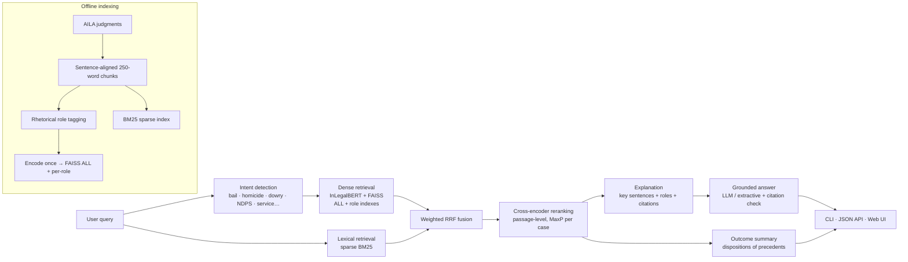

# AI Legal Assistant for Indian Case Law

[](https://github.com/Sayyam-wad/legal_ai/actions/workflows/ci.yml)


Hybrid retrieval and grounded, cited answers over 2,914 Indian Supreme Court judgments (AILA FIRE 2019). Combines a fine-tuned InLegalBERT bi-encoder, sparse BM25, rhetorical role-aware FAISS indexes, cross-encoder reranking, LLM answer synthesis with citation verification, and outcome analysis of precedents.

> Research aid only — not legal advice. The corpus is a fixed snapshot and does not include recent judgments.

## Highlights

- **Hybrid retrieval** — dense (fine-tuned InLegalBERT, FAISS) + lexical (BM25) candidates fused with weighted reciprocal-rank fusion, so exact section numbers and legal terms aren't lost to embeddings.
- **Fast sparse BM25** — precomputed BM25 weights in a SciPy sparse matrix: ~4 ms per query over 58,589 passages vs ~4.7 s with `rank_bm25` (**~1,200× faster**).
- **Grounded answers (RAG)** — Claude, any OpenAI-compatible API, or a local Ollama model writes a short answer citing `[C833]`-style case IDs; citations to documents that weren't retrieved are detected and stripped. Works fully offline with an extractive fallback.
- **Rhetorical role awareness** — sentence-level tagging into 12 roles (ratio, final ruling, issue, facts, arguments…) drives intent-specific indexes and explanation.
- **Outcome analysis** — the real disposition of each retrieved judgment (allowed / partly allowed / dismissed / disposed of) is extracted for **97%** of the corpus, together with the appellant type and the provisions cited.
- **Reproducible evaluation** — MAP / MRR / P@10 / Recall / nDCG against the official AILA relevance judgments, with a committed query-level train/test split to prevent leakage.
- **Production touches** — Flask web UI + JSON API, Docker image, GitHub Actions CI (lint + tests + benchmark), 16 unit tests.

---

## Architecture



---

## What a response contains

For a question such as *"Can a dying declaration alone be the basis of a murder conviction?"*:

- **Answer** — 3–6 sentences, each claim citing the judgment it comes from (links jump to that case in the web UI).
- **Relevant judgments** — title, year, relevance (cross-encoder probability), outcome, appellant, provisions cited, and the key passages that matched, tagged with their rhetorical role.
- **Relevant statutes** from the AILA statute set.
- **Outcomes in similar cases** — counts of allowed / dismissed etc., with a note on who appealed.

---

## Quick start

```bash
git clone https://github.com/Sayyam-wad/legal_ai.git
cd legal_ai
conda create -n legal_ai python=3.11 -y && conda activate legal_ai
pip install -r requirements.txt

python preprocess.py        # ~15 s  → CSVs, chunks, outcomes, citations
python tag_roles.py         # ~1 min → rhetorical roles
python build_role_index.py  # encodes ~59k chunks once (~10 min GPU) + BM25 index
```

The raw AILA files ship in `data/raw/` (re-download with `python download_data.py`). Embeddings are cached, so re-tagging and rebuilding does not re-encode.

### Use it

```bash
python assistant.py -q "anticipatory bail in a dowry harassment case" --answer
python assistant.py -q "..." --json        # structured output
python assistant.py --no-rerank            # faster, skips the cross-encoder
python app.py                              # web UI at http://127.0.0.1:5000
```

**API:** `POST /api/ask` with `{"query": "...", "top_k": 5, "answer": true}` · `GET /api/health`

### Answer generation

| Setting | Effect |
|---|---|
| `ANTHROPIC_API_KEY=...` | Claude writes the answer (model via `LEGAL_AI_LLM_MODEL`) |
| `OPENAI_API_KEY=...` | any OpenAI-compatible API |
| `OPENAI_BASE_URL=http://localhost:11434/v1` | a local model through Ollama |
| none | extractive answer from the top key passages (no network) |

Force one with `LEGAL_AI_LLM=anthropic|openai|extractive`.

### Docker

```bash
docker build -t legal-ai .
docker run -p 5000:5000 -v $PWD/faiss_indexes:/app/faiss_indexes legal-ai
```

---

## Evaluation

`evaluate.py` scores AILA Task 1 (rank all 2,914 cases for each query against 195 official relevant pairs):

```bash
python evaluate.py --methods bm25 dense hybrid rerank --split test
```

BM25 baseline (reproduced by CI on every push):

| Split | MAP | MRR | P@10 | R@100 | nDCG@10 |
|---|---|---|---|---|---|
| all 50 queries | 0.119 | 0.222 | 0.052 | 0.308 | 0.139 |
| 10 held-out test queries | 0.080 | 0.262 | 0.070 | 0.316 | 0.116 |

For context, the best AILA 2019 Task 1 systems reached about 0.15 MAP. Run the `dense`, `hybrid` and `rerank` methods after building the indexes to compare the neural pipeline against this baseline.

**Leakage warning.** A model fine-tuned on AILA queries must be evaluated on queries it never saw. `prepare_training_data.py` uses the fixed split in `data/processed/query_split.json` (committed); fine-tune on `train`, evaluate with `--split test`. The published Hugging Face model may have been trained on all 50 queries, in which case its scores on any AILA query are optimistic.

### Fine-tuning

```bash
python prepare_training_data.py   # query-level split, BM25-mined positives + hard negatives
python finetune.py                # TripletLoss; held-out accuracy before/after
python build_role_index.py --model models/finetuned_legal_bert
python evaluate.py --split test
```

Held-out triplet accuracy uses hard negatives from unseen queries, so it is much lower than — and not comparable to — an accuracy measured on a random triplet split.

---

## Tech stack

| Component | Implementation |
|---|---|
| Bi-encoder | InLegalBERT fine-tuned on AILA 2019 ([Sayyam9/legal-bert-aila-finetuned](https://huggingface.co/Sayyam9/legal-bert-aila-finetuned)) |
| Lexical retrieval | BM25 on a SciPy sparse matrix (`lexical.py`) |
| Fusion | Weighted reciprocal-rank fusion |
| Reranker | `cross-encoder/ms-marco-MiniLM-L-12-v2` |
| Vector search | FAISS (L2, matching triplet-loss training) |
| Answer synthesis | Claude / OpenAI-compatible / Ollama, with citation validation |
| Role tagging | Rule-based, sentence-level, 12 roles, multi-label per chunk |
| Serving | Flask + gunicorn, Docker |
| Quality | pytest, ruff, GitHub Actions |
| Dataset | AILA FIRE 2019 — 2,914 cases, 197 statutes, 50 queries |

## Project structure

```
legal_ai/
├── config.py                 Paths, model names, chunk size, device selection
├── legal_text.py             Sentence splitting, chunking, headers, outcomes, citations
├── lexical.py                Sparse BM25 index
├── preprocess.py             Raw AILA files → CSVs + chunks
├── tag_roles.py              Sentence-level rhetorical role tagging
├── build_role_index.py       Encode once → ALL + per-role FAISS indexes + BM25
├── assistant.py              LegalAssistant: hybrid retrieval, rerank, explain + CLI
├── answer.py                 Grounded answer synthesis with citation checks
├── app.py                    Flask web UI + JSON API
├── evaluate.py               MAP / MRR / P@10 / Recall / nDCG on AILA
├── prepare_training_data.py  Triplets: query-level split, hard negatives
├── finetune.py               Bi-encoder fine-tuning
├── tests/                    Unit tests (pytest)
├── Dockerfile, .github/      Container + CI
└── data/                     raw AILA files, processed CSVs, query split
```

Settings can be overridden with environment variables: `LEGAL_AI_BI_ENCODER`, `LEGAL_AI_CROSS_ENCODER`, `LEGAL_AI_INDEX_DIR`, `LEGAL_AI_DEVICE`, `LEGAL_AI_LLM`, `LEGAL_AI_LLM_MODEL`.

## Known limitations

- The reranker is a general-domain MS MARCO model; a legal cross-encoder fine-tuned on AILA pairs would likely help.
- Role tagging is rule-based (~57% of chunks get at least one role); a classifier trained on the LREC / SemEval rhetorical-role corpora would be more accurate.
- "Outcome" is the disposition of the appeal. "Allowed" means the appellant won — sometimes the State — so it is not the same as "relief for the accused".
- `data/processed/metadata.csv` and `ner_entities.csv` are not produced from the AILA files and are not used by the pipeline.

## References

- AILA FIRE 2019: Artificial Intelligence for Legal Assistance
- Paul et al., *Pre-trained Language Models for the Legal Domain: A Case Study on Indian Law* (InLegalBERT)
- Cormack et al., *Reciprocal Rank Fusion outperforms Condorcet and individual rank learning methods* (SIGIR 2009)
- Kalamkar et al., *Corpus for Automatic Structuring of Legal Documents* (LREC 2022); SemEval-2023 Task 6

## Contributors

Vishwass Khattarr · Sayyam Wad · RaghuRumble · Saanvi09
